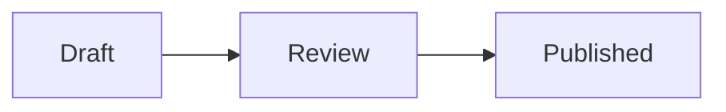

# Markdown reference

The Markdown syntax a note's preview renders, including math, diagrams, and the HTML tags it allows.

**Conventions.** Notes use GitHub-Flavored Markdown with one difference: a single `Enter` is a line break. Two lines with no blank line between them render as two lines, not one paragraph. Leave a blank line to start a new paragraph.

To see the result as you type, switch the note to **Split** at the right of the toolbar.

## Text

| To get | Type |
|---|---|
| Bold | `**bold**` |
| Italic | `*italic*` |
| Strikethrough | `~~struck~~` |
| Inline code | `` `code` `` |
| Link | `[text](https://example.com)` |
| Automatic link | `https://example.com` |
| Literal character | `\*` (backslash before a Markdown character) |

Links to `http://` and `https://` addresses open in a new tab.

## Headings and blocks

| To get | Type |
|---|---|
| Heading 1 to 6 | `#` to `######`, then a space |
| Blockquote | `> ` at the start of a line |
| Horizontal rule | `---` on its own line, after a blank line |
| Bullet list | `- `, `* `, or `+ ` |
| Numbered list | `1. ` |
| Nested item | Indent the item under the one above |
| Task | `- [ ] ` (open) or `- [x] ` (done) |

A line with only `-` under a paragraph stays an empty bullet. It does not turn the line above into a heading.

## Tables

Separate cells with `|`, and put a row of `---` under the header row:

```text
| Name  | Role     |
| ----- | -------- |
| Alice | Designer |
| Bob   | Engineer |
```

Add `:` to the separator to align a column: `:---` (left), `:---:` (center), `---:` (right).

## Images

| To get | Type |
|---|---|
| Image | `` |
| Image at a set size | `` |

See [Allowed HTML](#allowed-html) for the rules on ``.

## Code blocks

Open and close a block with three backticks. Put a language name after the opening fence to highlight it:

````text
```python
print("hello")
```
````

The source pane highlights these languages, by name or alias:

| Language | Names you can use |
|---|---|
| JavaScript | `javascript`, `js`, `mjs`, `cjs`, `node`, `jsx` |
| TypeScript | `typescript`, `ts`, `mts`, `cts`, `tsx` |
| JSON | `json`, `jsonc`, `json5` |
| Python | `python`, `py` |
| CSS | `css` |
| HTML | `html`, `htm`, `xml`, `svg` |
| SQL | `sql`, `postgres`, `postgresql`, `mysql` |
| YAML | `yaml`, `yml` |
| Shell | `shell`, `sh`, `bash`, `zsh`, `console`, `shellsession` |
| Go | `go`, `golang` |
| Rust | `rust`, `rs` |
| C and C++ | `c`, `h`, `cpp`, `c++`, `cc`, `cxx`, `hpp` |
| Java | `java` |

The preview highlights these and many other common languages. Each code block in the preview has a **Copy** button.

## Math

| To get | Type |
|---|---|
| Inline math | `$E = mc^2$` |
| Display math | `$$` on its own line, the formula, then `$$` on its own line |

Math uses LaTeX syntax. To show a dollar sign that would otherwise start math, type `\$`.

## Diagrams

Use `mermaid` as the fence language to draw a [Mermaid](https://mermaid.js.org/) diagram, such as a flowchart or sequence diagram:

````text

````

The diagram follows the light or dark theme and redraws as you type. The first diagram in a note can take a moment to appear; until then you see its source.

When a diagram can't be drawn, its source stays on screen with a message above it that starts with `Diagram error:`. These features are refused:

| Not allowed | Message |
|---|---|
| Image shapes (`@{ img: … }`) | `Diagram error: image shapes are not allowed` |
| Sequence actor icons | `Diagram error: actor icons are not allowed` |
| `url(…)` or `@import` in diagram styles | `Diagram error: CSS that loads a URL is not allowed` |
| HTML that loads a URL | `Diagram error: HTML that loads a URL is not allowed` |
| A diagram over 50,000 characters | `Diagram error: source is longer than 50000 characters` |

These are ignored without a message:

- `%%{init: …}%%` directives and front matter inside the fence, including `title:`
- Bold, italic, and other HTML formatting in labels. `<br/>` still breaks a line.

## Allowed HTML

The preview shows other HTML as plain text. These two tags are the exceptions.

| Tag | Rules |
|---|---|
| `<details>` and `<summary>` | Put each tag on its own line. Keep the summary on one line. Use `<details open>` to start expanded. The body between the tags is ordinary Markdown, so lists, code blocks, and nested foldouts work. |
| `` | Only `src`, `alt`, `width`, and `height`. Width and height must be a whole number or a percentage, such as `400` or `50%`. |

A foldout looks like this:

```text
<details>
<summary>Meeting notes</summary>

- Alice: ship the beta
- Bob: update the docs

</details>
```

An `` tag with any other attribute, or a value like `width="400px"`, shows as plain text in the preview.

## Related

- [Write and format](/notes/write-and-format) to apply most of this from the toolbar.
- [Keyboard shortcuts](/notes/keyboard-shortcuts) for formatting keys.
- [Notes](/notes/) for an overview of the editor.
